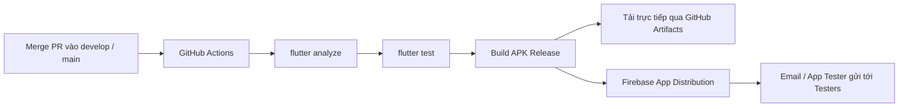

# Hướng Dẫn Vận Hành Pipeline Phân Phối Thử Nghiệm (App Distribution Guide)

Tài liệu này hướng dẫn cách cấu hình, kích hoạt và nhận bản build thử nghiệm tự động cho dự án **Vocabik Mobile App**.

---

## 1. Cơ Chế Hoạt Động Của Pipeline

Pipeline được định nghĩa tại file [app_distribution.yml](file:///.github/workflows/app_distribution.yml).



### Các sự kiện kích hoạt (Triggers):
1. **Tự động sau khi merge code:** Bất kỳ commit nào được push/merge vào nhánh `develop` (hoặc `main`) sẽ tự động kích hoạt pipeline.
2. **Kích hoạt thủ công (Manual Dispatch):** 
   - Vào tab **Actions** trên GitHub > Chọn workflow **App Distribution Pipeline**.
   - Bấm **Run workflow** > Có thể nhập ghi chú `release_notes` riêng nếu cần.

---

## 2. Thiết Lập GitHub Secrets (Chỉ cần làm 1 lần)

Để GitHub Actions có quyền ký số APK Release nhất quán và tải APK lên Firebase App Distribution, cần cấu hình các Secret trong repository GitHub:

1. Truy cập Repository trên GitHub: **Settings** > **Secrets and variables** > **Actions**.
2. Nhấn nút **New repository secret**.

### A. Nhóm Secrets cấu hình Ký số APK (Release Signing Key):

| Tên Secret | Bắt buộc | Mô Tả & Giá Trị |
| :--- | :---: | :--- |
| `ANDROID_KEYSTORE_BASE64` | **Có** | Chuỗi Base64 của file keystore đã lưu. |
| `KEYSTORE_PASSWORD` | **Có** | Mật khẩu để mở file Keystore. |
| `KEY_ALIAS` | Không *(Mặc định `vocabik-key-alias`)* | Tên Alias trong keystore (ví dụ: `vocabik-key-alias`). |
| `KEY_PASSWORD` | **Có** | Mật khẩu của Key Alias. |

> [!TIP]
> **Cách lấy chuỗi `ANDROID_KEYSTORE_BASE64` nhanh trên Windows PowerShell:**
> ```powershell
> [Convert]::ToBase64String([IO.File]::ReadAllBytes("duong_dan_toi_file_keystore.jks")) | Set-Clipboard
> ```
> Lệnh trên sẽ tự động đọc file keystore, chuyển thành Base64 và sao chép thẳng vào clipboard để bạn Paste trực tiếp vào ô Secret trên GitHub.
> 
> *Lưu ý:* Nếu các secret này chưa được cấu hình, hoặc khi developer build trực tiếp tại máy cá nhân, hệ thống build Gradle sẽ tự động fallback về signing key mặc định (`debug`) để không gây gián đoạn quy trình phát triển.

### B. Nhóm Secrets phân phối Firebase:

| Tên Secret | Bắt buộc | Mô Tả & Giá Trị |
| :--- | :---: | :--- |
| `FIREBASE_APP_ID` | Không *(Có sẵn mặc định)* | `1:621884720913:android:556ccdf3cab9f4e87d6eb0` (Được lấy từ [google-services.json](file:///android/app/google-services.json)). |
| `FIREBASE_SERVICE_ACCOUNT` | **Có** | Toàn bộ nội dung JSON của Google Service Account có quyền Firebase App Distribution Admin. |

### Cách lấy `FIREBASE_SERVICE_ACCOUNT` (JSON):
1. Đăng nhập [Google Cloud Console](https://console.cloud.google.com/) với tài khoản quản lý project `vocabik-entertain`.
2. Chọn project `vocabik-entertain`.
3. Vào **IAM & Admin** > **Service Accounts** (Tài khoản dịch vụ).
4. Nhấn **Create Service Account**:
   - Tên: `github-app-distribution`
   - Role (Vai trò): Chọn **Firebase App Distribution Admin** (Quản trị viên Phân phối ứng dụng Firebase).
5. Sau khi tạo xong, bấm vào Service Account vừa tạo > Tab **Keys** (Khóa) > **Add Key** > **Create new key** > Chọn định dạng **JSON** > Bấm **Create**.
6. File `.json` sẽ được tải về máy. Mở file đó bằng Notepad, copy toàn bộ nội dung và dán vào secret `FIREBASE_SERVICE_ACCOUNT` trên GitHub.

> [!TIP]
> Nếu chưa thiết lập Secret `FIREBASE_SERVICE_ACCOUNT`, pipeline vẫn chạy kiểm thử, build APK và tải lên **GitHub Artifacts** thành công để dev có thể tải trực tiếp file `.apk` về máy.

---

## 3. Quản Lý Nhóm Tester Trên Firebase

1. Đăng nhập [Firebase Console](https://console.firebase.google.com/) > Chọn project `vocabik-entertain`.
2. Trong menu bên trái, tìm mục **Release & Monitor** > **App Distribution**.
3. Chọn tab **Testers & Groups**:
   - Bấm **Add group** và tạo nhóm có tên `internal-testers`.
   - Nhập danh sách email của các Tester, QA, và thành viên trong team.
4. Khi pipeline hoàn thành, mọi thành viên trong nhóm `internal-testers` sẽ tự động nhận được email thông báo có bản build mới kèm link cài đặt.

---

## 4. Hướng Dẫn Tester Cài Đặt Ứng Dụng

Tester có thể nhận và cài đặt bản test bằng 2 cách:

### Cách 1: Qua Firebase App Tester (Khuyến nghị cho QA/Testers)
1. Tester mở email mời từ Firebase App Distribution trên điện thoại Android.
2. Bấm **Get Started** và tải ứng dụng hỗ trợ **App Tester** của Google.
3. Từ đó về sau, mỗi khi pipeline phát hành bản mới, App Tester sẽ thông báo và cho phép cập nhật chỉ với 1 nút bấm (không cần tải file thủ công).

### Cách 2: Tải trực tiếp từ GitHub Actions (Dành cho Developers)
1. Vào tab **Actions** trên repo GitHub > Bấm vào lượt chạy gần nhất của **App Distribution Pipeline**.
2. Cuộn xuống phần **Artifacts** ở dưới cùng.
3. Tải file `vocabik-test-apk-run-xxx.zip`, giải nén lấy file `.apk` và cài đặt trực tiếp vào thiết bị hoặc Android Emulator.

---

## 5. Quy Chuẩn Đánh Số Phiên Bản (Versioning)

Để đảm bảo không bị lỗi xung đột hoặc từ chối đè bản build cũ:
- `versionName`: Được lấy từ `version` trong `pubspec.yaml` (ví dụ: `1.0.0`).
- `versionCode / buildNumber`: Tự động gán bằng số thứ tự lượt chạy trên GitHub Actions (`${{ github.run_number }}`). Mỗi lần merge mã nguồn sẽ tạo ra một build number tăng dần duy nhất.
