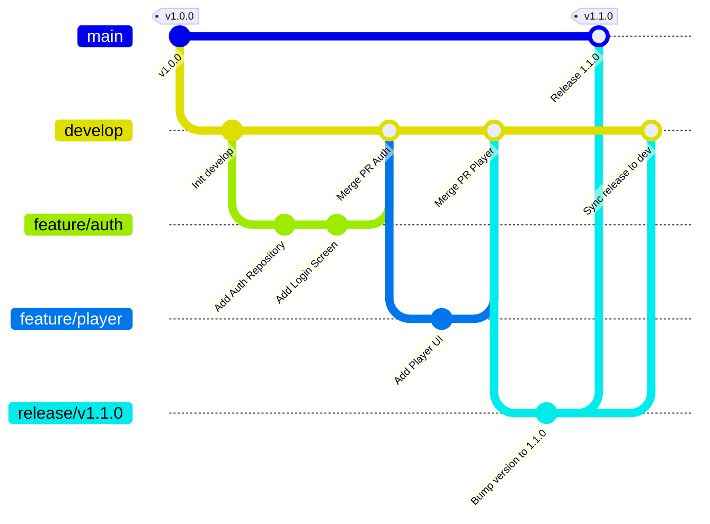

# Chiến Lược Phân Nhánh Git (Git Branching Strategy) - Vocabik Mobile App

Tài liệu này quy định chiến lược phân nhánh (Branching Strategy), quy tắc đặt tên, và quy trình Pull Request (PR) cho dự án **Vocabik Mobile App**. 

Chiến lược được thiết kế dựa trên mô hình **Gitflow kết hợp Trunk-Based (GitHub Flow Hybrid)**, tối ưu cho dự án Flutter sử dụng **Feature-First Clean Architecture**, nhiều môi trường build (Dev/Staging/Production) và tích hợp **CI/CD (GitHub Actions)**.

---

## 1. Hệ Thống Nhánh Chính (Main Branches)

| Tên Nhánh | Loại | Mục Đích & Phạm Vi | Bảo Vệ (Protection Rules) |
| :--- | :--- | :--- | :--- |
| `main` | Vĩnh viễn (Permanent) | Chứa mã nguồn ổn định nhất đang chạy trên **Production (App Store & Google Play)**. Mỗi lần merge vào `main` bắt buộc phải được đánh tag phiên bản (`vX.Y.Z`). | **Khóa trực tiếp**. Bắt buộc PR + Code Review + CI Passed mới được merge. |
| `develop` | Vĩnh viễn (Permanent) | Nhánh tích hợp chính (Integration branch) cho môi trường **Development/Staging**. Toàn bộ tính năng mới hoàn thành sẽ được tập hợp tại đây để kiểm thử nội bộ. | **Khóa trực tiếp**. Yêu cầu PR từ nhánh `feature/*` hoặc `bugfix/*`. |

---

## 2. Các Nhánh Hỗ Trợ (Supporting Branches)

### 2.1. Nhánh Feature (`feature/*`)
*   **Mục đích**: Phát triển từng tính năng riêng biệt (ví dụ: Auth, Player, Leaderboard) hoặc các thành phần UI trong `packages/vocabik_ui`.
*   **Nhánh xuất phát**: `develop`
*   **Nhánh merge về**: `develop`
*   **Quy tắc đặt tên**:
    *   `feature/<short-description>` (Ví dụ: `feature/auth-login`, `feature/player-subtitle`)
    *   Hoặc gắn mã Ticket: `feature/<ticket-id>-<short-description>` (Ví dụ: `feature/VOC-101-google-sign-in`)

### 2.2. Nhánh Bugfix (`bugfix/*`)
*   **Mục đích**: Sửa các lỗi phát sinh trong quá trình phát triển hoặc kiểm thử trên môi trường Staging/Development.
*   **Nhánh xuất phát**: `develop`
*   **Nhánh merge về**: `develop`
*   **Quy tắc đặt tên**: `bugfix/<ticket-id>-<short-description>` (Ví dụ: `bugfix/VOC-205-fix-theme-cubit-leak`)

### 2.3. Nhánh Release (`release/*`)
*   **Mục đích**: Chốt phiên bản chuẩn bị đóng gói phát hành lên Store. Nhánh này dùng để chạy Regression Test, tăng `version/build number` trong `pubspec.yaml`, và sửa lỗi phút chót (Minor fixes).
*   **Nhánh xuất phát**: `develop`
*   **Nhánh merge về**: Cả `main` VÀ `develop`
*   **Quy tắc đặt tên**: `release/vX.Y.Z` (Ví dụ: `release/v1.0.0`)

### 2.4. Nhánh Hotfix (`hotfix/*`)
*   **Mục đích**: Sửa các lỗi **khẩn cấp (Critical Bugs/Crash)** xảy ra trên môi trường Production mà không thể chờ chu kỳ release tiếp theo.
*   **Nhánh xuất phát**: `main`
*   **Nhánh merge về**: Cả `main` VÀ `develop`
*   **Quy tắc đặt tên**: `hotfix/vX.Y.Z` (Ví dụ: `hotfix/v1.0.1-fix-iap-crash`)

---

## 3. Quy Trình Làm Việc (Git Workflow)



### Các bước làm việc của Lập trình viên:

1. **Bắt đầu tính năng mới**:
   ```bash
   git checkout develop
   git pull origin develop
   git checkout -b feature/VOC-101-auth-login
   ```
2. **Cam kết mã nguồn (Commit Rules)**:
   * Tuân thủ chuẩn [Conventional Commits](https://www.conventionalcommits.org/):
     * `feat: add google sign in usecase`
     * `fix: handle expired token gracefully`
     * `refactor: optimize ThemeCubit persistent state`
     * `style: update primary color in design system`
     * `test: add unit test for AuthRepository`
3. **Tạo Pull Request (PR)**:
   * Đẩy nhánh lên remote: `git push -u origin feature/VOC-101-auth-login`
   * Tạo PR từ `feature/VOC-101-auth-login` vào `develop` trên GitHub.

---

## 4. Quy Tắc Merge & Tự Động Hóa CI/CD

### 4.1. Tiêu Chuẩn Cho Một Pull Request (PR Checklists)
Trước khi merge PR vào `develop` hoặc `main`, bắt buộc phải vượt qua:
* [x] **Static Analysis**: Không còn lỗi linting (`flutter analyze`).
* [x] **Code Format**: Tuân thủ chuẩn format (`dart format`).
* [x] **Automated Tests**: Toàn bộ Unit Test và Widget Test đều **PASS** (`flutter test`).
* [x] **Code Review**: Tối thiểu **1 reviewer** chấp thuận (Approve).
* [x] **Clean Architecture Check**: Không vi phạm phụ thuộc tầng (UI không gọi trực tiếp Data Source, Domain độc lập hoàn toàn với Flutter UI).

### 4.2. Chiến Lược Merge (Merge Strategies)

| Hướng Merge | Phương Thức Merge | Lý Do |
| :--- | :--- | :--- |
| `feature/*` $\rightarrow$ `develop` | **Squash and merge** | Gộp nhiều commit nhỏ trong quá trình dev thành 1 commit duy nhất, giúp lịch sử `develop` gọn gàng, dễ rollback theo từng feature. |
| `bugfix/*` $\rightarrow$ `develop` | **Squash and merge** | Gộp lịch sử sửa lỗi gọn gàng. |
| `release/*` $\rightarrow$ `main` | **Create a merge commit** | Giữ nguyên các mốc commit trên nhánh release để dễ truy vết. |
| `hotfix/*` $\rightarrow$ `main` | **Create a merge commit** | Giữ nguyên vết sửa lỗi khẩn cấp. |

---

## 5. Áp Dụng Cho Cấu Trúc Dự Án Vocabik

Nhờ kiến trúc **Feature-First Clean Architecture**, việc phân nhánh mang lại lợi ích lớn:
1. **Phát triển độc lập**: Các Dev làm việc trên các nhánh `feature/*` khác nhau thường chỉ chỉnh sửa file trong thư mục riêng của mình (ví dụ: `lib/features/auth/` vs `lib/features/player/`), giúp **giảm thiểu Merge Conflict tối đa (lên tới 90%)**.
2. **Cập nhật Design System**: Các thay đổi liên quan đến UI nền tảng nằm ở `packages/vocabik_ui` nên được tạo nhánh riêng `feature/ui-xxx` và thông báo cho cả team trước khi merge vào `develop`.

---

## 6. Tóm Tắt Quy Trình Nhanh (Cheatsheet)

| Tác Vụ | Nhánh Nguồn | Nhánh Đích | Lệnh Tóm Tắt |
| :--- | :--- | :--- | :--- |
| **Làm tính năng mới** | `develop` | `feature/name` | `git checkout develop && git pull && git checkout -b feature/name` |
| **Sửa bug dev/staging** | `develop` | `bugfix/name` | `git checkout develop && git pull && git checkout -b bugfix/name` |
| **Chuẩn bị Release** | `develop` | `release/vX.Y.Z` | `git checkout develop && git pull && git checkout -b release/v1.0.0` |
| **Sửa hotfix app store** | `main` | `hotfix/vX.Y.Z` | `git checkout main && git pull && git checkout -b hotfix/v1.0.1` |
